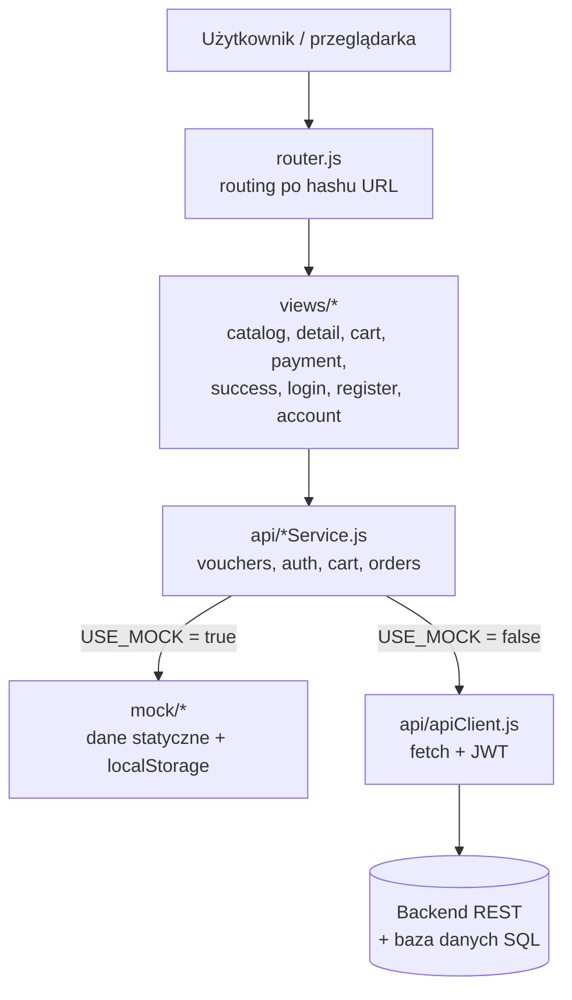

# VoucherShop – internetowy sklep z voucherami prezentowymi

> Projekt zaliczeniowy · aplikacja typu SPA (Single Page Application) w czystym HTML, CSS i JavaScript (ES Modules).

## 1. Cel projektu

Celem projektu jest zaprojektowanie i implementacja warstwy frontendowej sklepu internetowego
sprzedającego vouchery prezentowe (np. dzień w SPA, skok ze spadochronem, warsztaty baristyczne).
Aplikacja ma czytelną, modułową architekturę z wydzieloną warstwą dostępu do danych,
dzięki czemu w kolejnym etapie można ją podłączyć do backendu z relacyjną bazą danych
**bez zmian w kodzie widoków**.

## 2. Funkcjonalności

- **Katalog** voucherów z sekcją hero i filtrowaniem po kategorii oraz przedziale cenowym.
- **Szczegóły vouchera** – wybór progu cenowego z opisem zawartości pakietu, wybór ilości.
- **Koszyk** – zmiana ilości, usuwanie pozycji, podsumowanie (zapis w `localStorage`).
- **Płatność (symulowana)** – karta lub BLIK, walidacja formularza; dane karty nie są nigdzie zapisywane.
- **Konta użytkowników** – rejestracja z walidacją, logowanie, wylogowanie, profil z historią zamówień.
  W trybie demo hasła są solone i hashowane SHA-256 (Web Crypto API).
- **Interfejs** – glassmorphism, responsywność (RWD), obsługa klawiatury, `prefers-reduced-motion`.

## 3. Architektura

Aplikacja ma budowę warstwową. Widoki nie odwołują się bezpośrednio do `localStorage` ani do `fetch` –
korzystają wyłącznie z **serwisów**, które zwracają `Promise`. Serwis, w zależności od flagi
`USE_MOCK` w `js/config.js`, deleguje wywołanie do implementacji testowej (mock) albo do REST API
(wzorzec *Strategy / Adapter*).



Dodatkowe mechanizmy:
- **Router** (`js/router.js`) – mapuje `#/trasa/parametr` na funkcję renderującą widok; hash pozwala
  hostować aplikację na GitHub Pages bez konfiguracji serwera.
- **Zdarzenia** – `cartService` emituje `cart:changed`, na które reaguje licznik koszyka w nagłówku.
- **Bezpieczeństwo** – wszystkie dane użytkownika wstawiane do HTML przechodzą przez `esc()` (ochrona przed XSS).

## 4. Struktura katalogów

```
voucher-shop/
├── index.html              # szkielet strony, nagłówek z logo, ładowanie modułów
├── logo.svg                # logo i favicon
├── css/
│   ├── base.css            # zmienne motywu, typografia, tło
│   ├── layout.css          # nagłówek, stopka, hero
│   ├── components.css      # przyciski, chipy filtrów, karty
│   ├── views.css           # style widoków (szczegóły, koszyk, formularze…)
│   └── responsive.css      # RWD i dostępność
├── js/
│   ├── main.js             # punkt wejścia
│   ├── config.js           # API_BASE_URL, USE_MOCK, klucze localStorage
│   ├── router.js           # routing po hashu
│   ├── utils.js            # formatowanie, escapowanie, SHA-256, miniatury
│   ├── api/
│   │   ├── apiClient.js    # wrapper na fetch (JSON, token, błędy)
│   │   ├── vouchersService.js
│   │   ├── authService.js
│   │   ├── cartService.js
│   │   └── ordersService.js
│   ├── mock/
│   │   ├── data.js         # dane voucherów i progów cenowych
│   │   ├── mockDb.js       # „baza” w localStorage + symulacja opóźnienia
│   │   ├── vouchersMock.js
│   │   ├── authMock.js
│   │   ├── cartMock.js
│   │   └── ordersMock.js
│   └── views/
│       ├── header.js       # licznik koszyka, link konta
│       ├── catalog.js  detail.js  cart.js  payment.js  success.js
│       ├── login.js  register.js  account.js  notFound.js
├── img/                    # zdjęcia voucherów i tło (JPG/WebP)
└── docs/
    ├── API.md              # specyfikacja planowanych endpointów REST
    └── schema.sql          # proponowany schemat bazy danych
```

## 5. Uruchomienie lokalne

Moduły ES wymagają serwowania plików przez HTTP (nie działają z `file://`). Przykładowo:

```bash
# Python 3
python3 -m http.server 8080
# lub Node.js
npx serve .
```

Następnie otwórz <http://localhost:8080>. Projekt nie wymaga instalacji zależności ani procesu budowania.

**GitHub Pages:** Settings → Pages → *Deploy from branch* → `main` / `(root)`.

## 6. Przełączenie na prawdziwe API

1. Uruchom backend implementujący endpointy z [`docs/API.md`](docs/API.md)
   (schemat bazy: [`docs/schema.sql`](docs/schema.sql)).
2. W pliku `js/config.js` ustaw:
   ```js
   export const API_BASE_URL = 'https://twoj-serwer/api/v1';
   export const USE_MOCK = false;
   ```
3. Skonfiguruj na serwerze CORS dla domeny frontendu.

Żadne widoki nie wymagają modyfikacji – zmienia się wyłącznie implementacja wybierana przez serwisy.

## 7. Technologie

| Obszar | Technologia |
|---|---|
| Struktura | HTML5 (semantyczne znaczniki, ARIA) |
| Style | CSS3 – zmienne, Grid, Flexbox, `backdrop-filter`, media queries |
| Logika | JavaScript ES2022, moduły ES (`type="module"`), `async/await`, Fetch API |
| Bezpieczeństwo (demo) | Web Crypto API (SHA-256 + sól) |
| Czcionki | Google Fonts – Inter, Poppins |
| Hosting | GitHub Pages |
| Planowany backend | REST + relacyjna baza danych (PostgreSQL) |

## 8. Zespół

| Rola | Osoby |
|---|---|
| Frontend | Adrian, Szymon |

## 9. Ograniczenia wersji demonstracyjnej

- Płatności są symulowane – żadne środki nie są pobierane.
- Konta i zamówienia w trybie mock istnieją tylko w `localStorage` danej przeglądarki.


## 10. Źródła zdjęć (CREDITS)
Wszystkie zdjęcia to prawdziwe fotografie (nie AI) z Wikimedia Commons, przeskalowane do 800 px.

| Voucher | Autor | Źródło | Licencja |
|---|---|---|---|
| SPA (`img/spa.jpg`) | el ancora service (Panoramio) | https://commons.wikimedia.org/wiki/File:EL_ANCORA_SERVICE_-_panoramio.jpg | CC BY 3.0 |
| Kolacja (`img/kolacja.jpg`) | Robert Couse-Baker | https://commons.wikimedia.org/wiki/File:Candlelight_dinner_-_Flickr_-_Robert_Couse-Baker.jpg | CC BY 2.0 |
| Skok (`img/skok.jpg`) | Wlodek k1 | https://commons.wikimedia.org/wiki/File:Parachuting_at_the_Opole-Polska_Nowa_Wie%C5%9B_airfield,_2022.05.29_05.jpg | CC BY 3.0 |
| Kino (`img/kino.jpg`) | Carol M. Highsmith (Library of Congress) | https://commons.wikimedia.org/wiki/File:Auditorium_at_the_Perot_Theatre,_a_landmark_since_1924,_when_it_opened_as_the_Saenger_Amusement_Company%27s_%22Gateway_to_the_West%22_movie_theater_in_Texarkana,_Texas_LCCN2014630215.tif | Domena publiczna |
| Książki (`img/ksiazki.jpg`) | Immanuel Giel | https://commons.wikimedia.org/wiki/File:Richard_Booth%27s_Bookshop_09.jpg | CC0 |
| Gokarty (`img/gokarty.jpg`) | Genevieve (Flickr) | https://commons.wikimedia.org/wiki/File:Go_kart_racing_(6238710513).jpg | CC BY 2.0 |
| Kawa (`img/kawa.jpg`) | Kim Sanso | https://commons.wikimedia.org/wiki/File:Latte_art_3.jpg | CC0 |
| Joga (`img/joga.jpg`) | David Scott Yglesias | https://commons.wikimedia.org/wiki/File:Energy_Yoga_Teacher_Training_with_David_Scott_Yglesias.jpg | CC BY 4.0 |
| Tło strony (`img/bg.jpg`, `img/bg.webp`) | The Roaming Picture Taker (Flickr) | https://commons.wikimedia.org/wiki/File:Christmas_Lights,_Market_Place,_Derby_(54223053964).jpg | CC BY 2.0 |

Zdjęcia zostały przeskalowane i skompresowane (zmiana formatu), bez innych modyfikacji.
